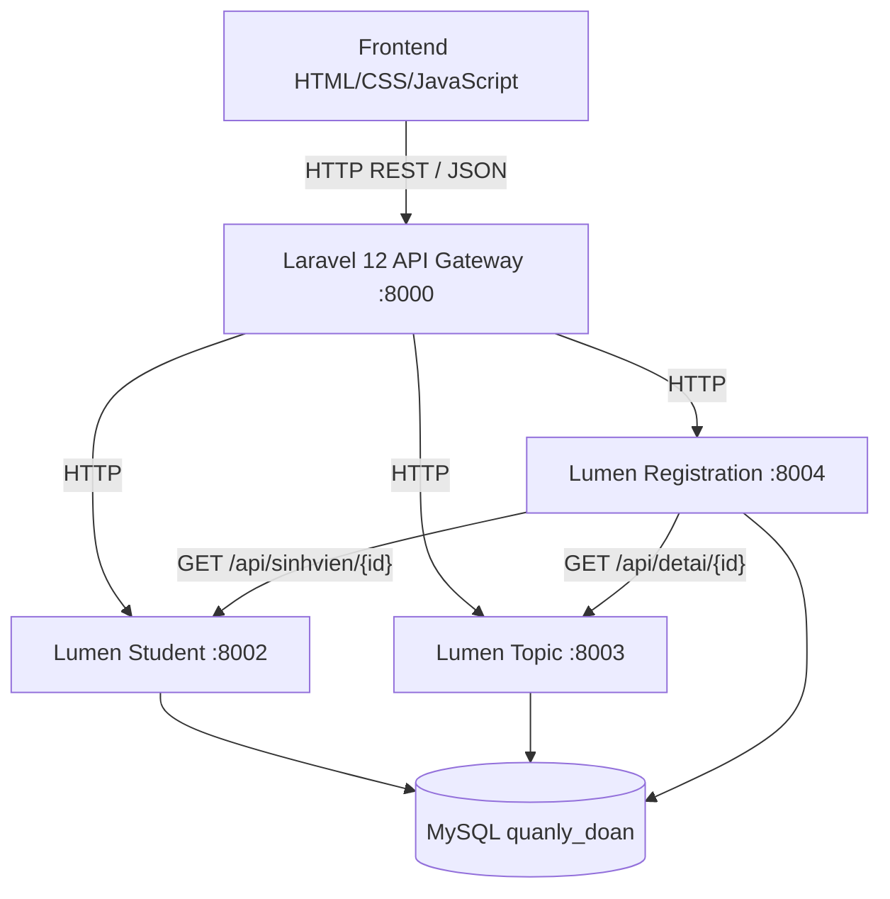
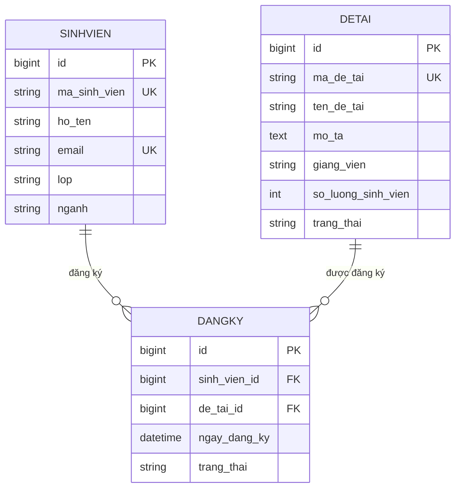

# Kiến trúc SOA quản lý đồ án

## Ranh giới dịch vụ

SinhVienService quản lý SINHVIEN; DeTaiService quản lý DETAI; DangKyService quản lý DANGKY, sức chứa và trạng thái đề tài liên quan. Controller nhận request, gọi validation và Service, trả JSON. Nghiệp vụ nằm trong Services.

Ba dịch vụ là ba tiến trình HTTP độc lập dùng chung một bộ mã Lumen. SERVICE_MODULE giới hạn route của tiến trình. Không chạy cả Laravel gateway và Lumen trong cùng PHP process. SERVICE_MODULE=all chỉ phục vụ phát triển/kiểm thử trong một tiến trình.

Frontend chỉ gọi gateway bằng fetch, không có credentials hay kết nối MySQL. Gateway không truy cập database; proxy giữ HTTP status, JSON và query filters. Dashboard tổng hợp dữ liệu qua ba REST API. API dùng lại được từ web, mobile, desktop và Postman.

Registration service kiểm tra tồn tại của sinh viên/đề tài qua HTTP trước khi mở transaction. Nếu upstream không truy cập được, trả 503. Việc kiểm tra lại bằng khóa hàng trong transaction tránh thay đổi dữ liệu giữa lookup và insert.

## Shared database

Thiết kế dùng một database với ba bảng như đề bài. Đây là SOA dùng schema chung, không phải mô hình microservices mỗi service có database riêng. Registration service cần quyền đọc/khóa SINHVIEN và đọc/ghi trạng thái DETAI để bảo vệ ràng buộc trong một transaction MySQL.

Khóa sinh viên rồi đề tài khi tạo đăng ký; khóa đề tài rồi đăng ký khi cập nhật/xoá. Các luồng cập nhật sức chứa/xoá đề tài cũng khóa cùng hàng đề tài. InnoDB và unique constraint giữ sức chứa, FK và cặp đăng ký. SQLite demo không chứng minh hành vi khóa đồng thời của MySQL.

Unique DANGKY(sinh_vien_id,de_tai_id), FK RESTRICT. Tất cả bảng có created_at/updated_at.
Chờ duyệt/đã duyệt chiếm chỗ; huỷ/từ chối trả chỗ. Trạng thái con_trong/da_du tự tính, ngung_nhan là quyết định quản trị.

## Luồng đăng ký

Frontend POST /api/dangky → Gateway → Registration Controller → validation → DangKyService → HTTP lookup Student/Topic → transaction kiểm tra FK/trùng/sức chứa → insert DANGKY → đồng bộ trạng thái DETAI → commit → JSON 201.

Gateway giới hạn proxy vào ba tài nguyên và ID số. Timeout/kết nối lỗi trả 503; response upstream không hợp lệ trả 502. CORS chỉ cho origin FRONTEND_URL.

Đăng nhập của hệ thống đồ án dùng `users` và `access_tokens` trong backend dùng chung database. Gateway chuyển tiếp Bearer token; mọi module Lumen xác thực và kiểm tra vai trò. API auth và quản lý tài khoản được phục vụ qua module sinhvien (hoặc all/auth). Admin cấp tài khoản và vai trò qua mục Tài khoản; giảng viên quản lý đề tài liên kết `DETAI.giang_vien_id`; sinh viên chỉ xem hồ sơ và đăng ký của mình. Xem [hướng dẫn tài khoản](accounts.md) để khởi tạo admin. Auth-service và các service nhà thuốc cũ không chạy cùng hệ thống này.

